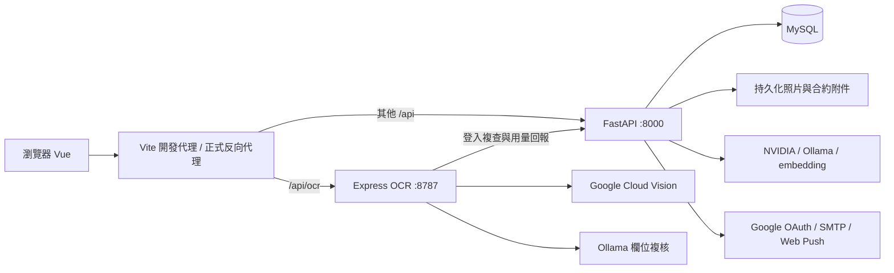

# 系統架構與模組

核對日期：2026-10-08。[返回入口](../README.md)

## 服務邊界

RentMate 是單一儲存庫中的三個應用程式。前端呈現租客、房東與管理員工作區；FastAPI 處理業務資料與授權；Express 處理契約 OCR。OCR 的背景欄位複核與 FastAPI 的合約分析是不同流程。

開發代理由 [`vite.config.ts`](../../vite.config.ts) 定義；`/api/ocr` 必須先於一般 `/api` 路徑分流。正式部署需自行提供同等代理規則，Vite 的開發代理不會被打包到 `dist/`。

## 原始碼分工

| 路徑 | 責任 |
| --- | --- |
| `src/router/index.ts` | Vue Router、工作區角色、維護模式與登入導向 |
| `src/pages/`、`src/components/` | 功能頁面、版型與互動元件 |
| `src/services/` | API 請求、認證標頭、錯誤與媒體下載 |
| `src/composables/` | 功能狀態、資料載入與 UI 流程 |
| `src/utils/` | 規則、格式化及純邏輯；多數 Vitest 測試在此 |
| `shared/` | 前後端共用的合約欄位、文件、地址與抽取規則 |
| `backend/main.py` | router 註冊、CORS、健康檢查、背景排程 |
| `backend/routers/` | HTTP API、驗證輸入與業務流程 |
| `backend/auth/` | 憑證、驗證碼、角色與房東工作區權限 |
| `backend/db/` | SQLAlchemy ORM、連線、加密欄位及 schema 檢查 |
| `backend/admin/`、`backend/notifications/` | 平台設定、稽核、監控、用量、通知派送 |
| `backend/ai/` | 去識別化、生成模型、embedding 與法規語料 |
| `server/` | Vision OCR、文字正規化、欄位裁切、複核與用量回報 |
| `public/data/`、`rag/` | 靜態清運資料、法規來源及語料工具 |
| `scripts/`、`backend/scripts/` | 資料更新、診斷、文件產生與驗證工具 |

`@` alias 指向專案根目錄，因此 `@/src/...` 是現有有效用法。Python 後端則使用 `from db...`、`from auth...` 等套件引用，啟動位置或 `--app-dir backend` 會影響 import。

## 主要業務流

| 流程 | 核心來源 | 資料與邊界 |
| --- | --- | --- |
| 帳號與多身分 | `routers/auth.py`、`auth/security.py` | `users` 與 `user_roles`；登入同時發 cookie 與 Bearer |
| 租客契約 | `routers/contract.py`、`contract_pdf.py` | OCR 校對後存入 `rentals`；分析、法規問答與 PDF 匯出分開 |
| 房東租務 | `landlord_properties.py`、`landlord_tenants.py`、`landlord_contracts.py` | 物件、房間、租客與 `landlord_leases`；附件另存磁碟 |
| 房東帳務 | `landlord_finance.py`、`db/billing.py` | 應收、收款、沖銷與支出；租客帳務另有 `tenant_landlord_leases.py` |
| 租約邀請 | `lease_invitations.py` | 公開摘要、登入接受及帳號綁定，不能只靠前端 token 參數授權 |
| 點交 | `inspection.py` | 項目、照片紀錄、比對結果與來源版本；支援房東租約的相容流程需配合近期 migration |
| 報修 | `repairs.py` | 工單、時間軸與照片；依租約和工作區檢查存取 |
| 筆記／共居 | `notes.py`、`households.py` | 個人筆記、共居成員與任務 |
| 通知 | `inbox_api.py`、`notifications/` | 站內信、排程、清運及房東提醒；寄信是否啟用依設定與模組而定 |
| 平台後台 | `admin.py` 與各 `admin_*` router | 帳號、內容、報修管理、稽核、監控與用量 |

## 資料與程序限制

`rentals` 與 `landlord_leases` 是兩套租約模型。新增房東租約不等同建立租客 OCR 契約；租客讀取房東租約與帳款走專用 API。串接時必須確認租約 ID 所屬模型。

後台的 `db/sqlstore.py` 提供近似 SQLite 的查詢介面，實際連到共用 SQLAlchemy engine。不能因為看見 `?` 參數或舊註解就推定仍在寫 SQLite 檔案。

FastAPI lifespan 內含通知與監控工作，每個應用程序各啟動一份。OCR 複核工作放在 Express 程序記憶體。增加 worker 或 replica 前，必須先處理排程重複執行、工作路由與記憶體工作遺失；目前不能據此宣稱支援任意水平擴充。
